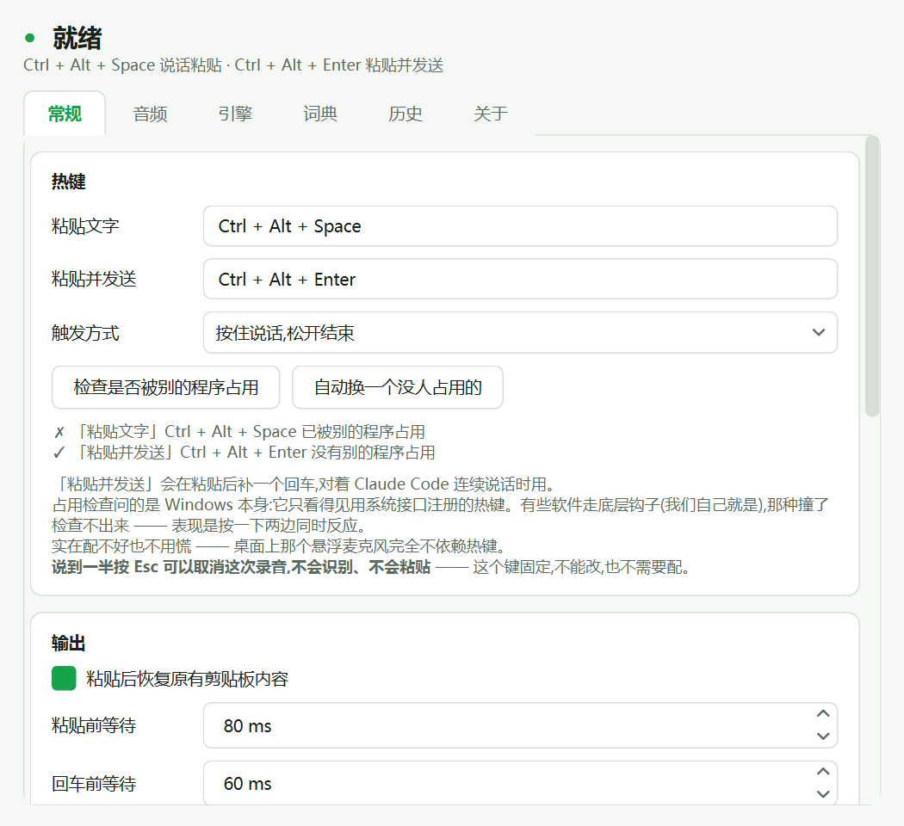
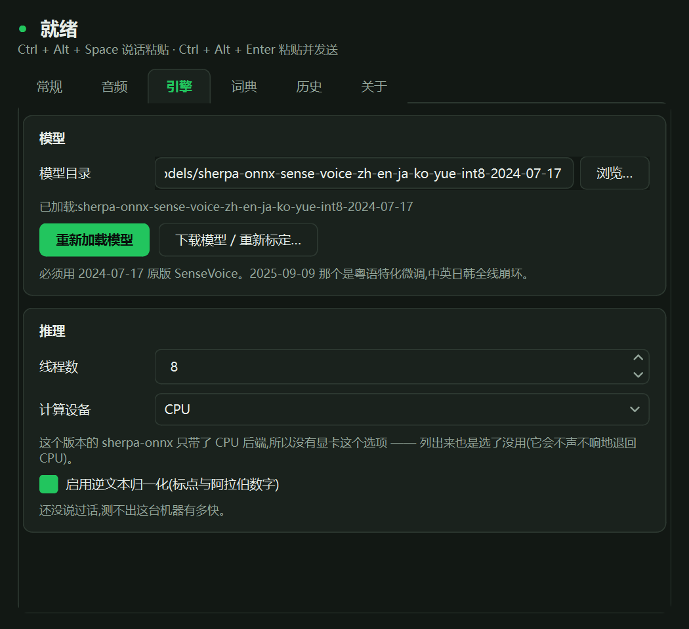
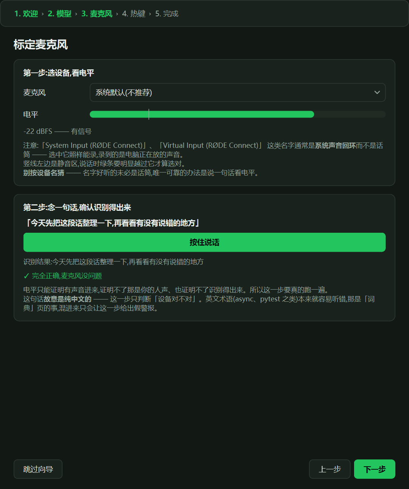
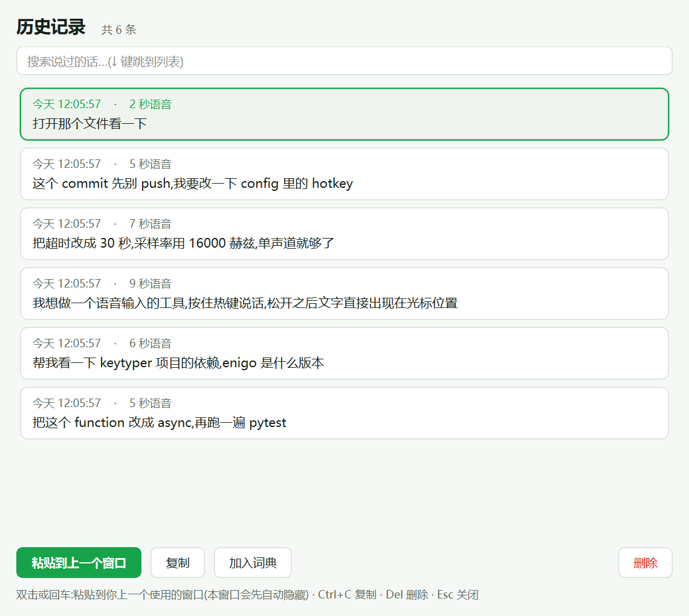

# VoiceInput

**按住热键说话,松开后文字直接出现在光标处。识别全程在你自己的电脑上完成,纯 CPU,音频不出机器。**

[下载 Windows 便携版](https://github.com/yoyoset/voiceinput/releases/latest) · [实测数据](docs/engine-benchmark.md) · [工程踩坑记录](docs/pitfalls.md)

<p>
  
  
</p>

---

## 为什么做它

我每天大量时间在对 AI 交代事情:需求、约束、改哪里、别动哪里。说一遍比打一遍快得多,
但现成的方案各有一处过不去:

| 我要的 | 云端语音输入 | 本地 Whisper large-v3 | VoiceInput |
|---|---|---|---|
| **声音不离开电脑** | ✗ 音频要上传 | ✓ | ✓ 识别在本机完成,不联网 |
| **不占显卡** | — | 要 GPU 才快 | ✓ 纯 CPU |
| **松开就出字** | 取决于网络 | CPU 上一句 5.6 秒的话要 37.6 秒 | ✓ 端到端约 380 ms |
| **自主可控** | 服务、价格、条款都在别人手里 | ✓ | ✓ 绿色软件,模型和程序都在你手里 |

所以它只做一件事:**把你说的话变成文字,放到光标处**。文字进聊天框、编辑器、Claude Code 的输入框,
和你手打没有区别。它不做语音命令,不替你操作电脑——该不该动手,由接收文字的那一方判断。

## 截图

| 设置:热键、输出 | 引擎:模型与推理 |
|---|---|
|  |  |

| 首次运行向导:真录一句话标定麦克风 | 历史记录:搜索、重新粘贴、加入词典 |
|---|---|
|  |  |

## 功能

- **按住说话,松开粘贴**;另一个热键在粘贴后补一个回车,连续对话用。两种触发方式:按住说话 / 按一下开始再按一下结束
- **说到一半按 Esc 取消**:不识别、不粘贴
- **悬浮麦克风**:桌面上一个小按钮,点一下也能开始说话,不依赖热键;托盘图标单击同样可以
- **粘贴后恢复剪贴板**:原来剪贴板里的文字、图片、富文本都会还原,不会因为说了一句话就把刚复制的截图弄丢
- **词典**:专有名词老被听错,加一条替换规则;历史记录里可以一键把某句话带进词典
- **历史记录**:本地 SQLite,可搜索,双击重新粘贴到上一个窗口
- **中英混说**:模型支持中、英、日、韩、粤;中英文之间自动补空格
- **失败一定看得见**:麦克风打不开、只录到静音、超过 120 秒上限、模型没加载,悬浮条上都会说清楚,不会"按了没反应"
- **热键占用检查**:一键检查是否被别的程序占用,或者自动换一个空闲组合
- **绿色软件**:配置、历史、日志都在程序目录旁边,不写注册表

## 下载与安装

1. 到 [Releases](https://github.com/yoyoset/voiceinput/releases/latest) 下载 `VoiceInput-<版本>-win-x64.zip`(约 207 MB,**已含语音模型**,不用再联网下载)
2. 解压到任意目录,双击 `VoiceInput.exe`
3. 首次运行会弹出设置向导:选麦克风 → **念一句话确认识别得出来** → 确认热键

系统要求:Windows x64(在 Windows 11 上开发和测试)。不需要显卡,不需要装 Python。

> 程序没有代码签名,Windows 可能提示"未知发布者"。Release 页给了 SHA256,可以核对。

## 使用

| 默认热键 | 行为 |
|---|---|
| 按住 `Ctrl + Alt + Space` | 说话,松开后把文字粘贴到光标处 |
| 按住 `Ctrl + Alt + Enter` | 同上,粘贴后再补一个回车 |
| `Esc`(说话时) | 取消这一次,不识别、不粘贴 |

热键都能在「常规」页改。默认组合在你的机器上被占用的话,点「自动换一个没人占用的」。

双击托盘图标打开设置;历史记录在单独的窗口里。

## 实测性能

测试机:Xeon E5-2698 v3(2014 年的服务器 CPU,单核偏弱),不用显卡。
详细过程见 [docs/engine-benchmark.md](docs/engine-benchmark.md)。

| | SenseVoice-Small int8(本工具) | faster-whisper large-v3 int8 |
|---|---|---|
| 运行设备 | CPU,8 线程 | CPU |
| 实时率 RTF | **0.054** | 6.317 |
| 一句 5.6 秒的话,推理耗时 | **0.29 s** | 37.6 s |
| 模型加载 | 2.9 s | 19.5 s |

**端到端**(松开热键 → 文字粘贴出去)实测 **380 ms**:推理占 79%,「粘贴前等待」占 21%,
后处理和剪贴板加起来不到 1 ms。

**取舍要说清楚**:在模型自带的测试音频上,faster-whisper 的用词更准(SenseVoice 会把个别词听错),
只是在 CPU 上慢到没法用于按住说话。VoiceInput 选了速度,专有名词靠「词典」兜底。

## 隐私与数据

- 识别在本机完成,**录音不上传,也不写成音频文件**,只在内存里用于识别
- 唯一的联网行为:向导里点「下载模型」时,从 GitHub(`k2-fsa/sherpa-onnx` 发布页)下载模型。便携版已经带了模型,用不到这一步
- 本地文件(都在程序目录旁边):`config.toml` 设置、`history.db` 识别历史、`voiceinput.log` 日志
- 没有任何统计、追踪、遥测

**卸载**:删掉程序目录即可。开过「开机自启」的话,再删掉启动文件夹里的快捷方式
(路径在「关于」页里列着,也有直接打开目录的按钮)。

## 常见问题

**按了热键没反应?**
多数是麦克风选错了。很多声卡驱动会提供一个"系统声音回环"设备,它也有电平,但录到的是电脑在放的声音。
在「音频」页或重新运行向导,**说一句话看识别结果**,不要只看电平表。

**某个词总是识别错?**
在「词典」页加一条替换;或者在历史记录里选中那句话,点「加入词典」。

**和别的软件热键冲突?**
「常规」页点「检查是否被别的程序占用」。注意:有些软件走底层键盘钩子(VoiceInput 自己也是),
那种冲突系统查不出来,表现是按一下两边同时反应——换一个组合就好。

**能用显卡加速吗?**
这一版的推理库只带了 CPU 后端。在 CPU 上已经是几百毫秒级,目前没有加显卡的必要。

**为什么模型必须是 2024-07-17 那一版?**
同一个发布页上的 2025-09-09 版是粤语特化微调,中英日韩全线崩坏,两个文件大小还一样。
向导里只提供 2024-07-17 这一个选项;手动放模型时请认准日期。

## 已知问题

- **精度还没用真人语音定标**。目前的判断基于模型自带测试音频和 TTS 合成音频,真人录音的字错误率还没系统测过
  (`bench/record_samples.py`)。如果错得太多,可能要加一层大模型纠错或提供云端选项
- **静音时模型会幻觉**(喂纯静音会吐出 `그.` 之类)。转写前用 `looks_silent()` 拦掉,文本层再兜一次底
- **只支持 Windows**:热键、剪贴板、自启都是 Windows 实现
- **不做语音命令控制电脑**(Talon 那种范式),语音只负责转成文字

---

## 从源码运行

需要 Python 3.13 和 [uv](https://docs.astral.sh/uv/)。

```bash
uv sync
uv run python -m voiceinput
```

首次运行的向导能一键下载模型。手动准备的话:

```bash
curl -L -o sv.tar.bz2 https://github.com/k2-fsa/sherpa-onnx/releases/download/asr-models/sherpa-onnx-sense-voice-zh-en-ja-ko-yue-int8-2024-07-17.tar.bz2
mkdir -p models && tar -xjf sv.tar.bz2 -C models/ && rm sv.tar.bz2
```

### 打包成便携版

```bash
uv run python build.py
```

产物在 `dist/VoiceInput/`,整个目录拷走即可。打包流程会先把 `dist` 里的 `config.toml` / `history.db`
备份到 `dist` 之外,打完再还原——绿色软件的数据和产物在同一个目录,"清理旧产物"曾经把用户数据一起删了
(见 [pitfalls.md](docs/pitfalls.md))。**对外分发前要手动去掉这两个文件和日志。**

打包完务必跑一次自检:

```bash
dist/VoiceInput/VoiceInput.exe --selftest
```

自检会真的加载模型跑一次推理,并检查设备、热键、剪贴板、Qt 字体和界面渲染,结果写在 `selftest.txt`。
**"PyInstaller 没报错"不等于产物能用**——这个项目出过打包成功但 exe 完全起不来的情况。

调试打包问题:`VOICEINPUT_CONSOLE=1 uv run python build.py` 打出带控制台的版本;
`VOICEINPUT_TRACE=1` 会往 `startup-trace.txt` 逐步写启动面包屑。

### 测试

```bash
uv run pytest tests/ -q
```

755 项。集成测试会加载真实模型跑真实音频,模型或 `bench/tts/` 不存在时自动跳过;
下载测试用本地 HTTP 服务模拟网络中断;UI 测试用 offscreen 平台,不弹窗。

界面截图用 `uv run python bench/render_ui.py` 重新生成(输出到 `bench/shots/`)。
**不能设 `QT_QPA_PLATFORM=offscreen`**:那个平台加载到的字体是 0 个,中文全是豆腐块。

## 设计取舍

**为什么走剪贴板而不是模拟按键**:同机的 keytyper 项目(Rust + enigo)已经证明逐字符 VK 模拟打不出中文
(`ascii_vk()` 对非 ASCII 返回 `None`)。所以用剪贴板 + Ctrl+V,粘贴后恢复原有剪贴板内容。

**为什么不用现成的 OpenWhispr**:它的本地引擎只有 whisper.cpp 和 sherpa-onnx 的 Parakeet/Nemotron,
Parakeet 不支持中文,没有 SenseVoice 选项。

**为什么是 SenseVoice 而不是 faster-whisper**:见上面「实测性能」。纯 CPU 就够,少一整条 CUDA 依赖链;
代价是精度略逊。

**为什么失败一定要有提示**:麦克风打不开、只录到静音、模型没加载——静默失败的话,
用户会以为没按到热键而反复重试。所以悬浮条上必须看得见。

**为什么最早的默认热键 `Ctrl + Win` 被换掉**:纯修饰键组合会被它的每个超集触发,
Ctrl+Win+左/右(Windows 切虚拟桌面)、别的软件的 Ctrl+Win+X 都会误触。

**为什么入口是根目录的 `entry.py`**:PyInstaller 把入口当顶层脚本执行,`__package__` 为空,
包内相对导入全部报错;而 `python -m voiceinput` 在源码环境下正常,本地测不出来。
入口逻辑放在 `voiceinput/cli.py`,外面两个薄壳用绝对导入。

## 项目结构

```
entry.py           PyInstaller 入口(绝对导入,原因见上)
voiceinput/
  cli.py           入口逻辑 + 启动面包屑
  config.py        配置层(TOML,程序目录旁)
  audio.py         设备枚举、电平、录音
  asr/             引擎抽象 + SenseVoice 实现
  postprocess.py   纯函数:去标记、术语替换、中英空格
  metrics.py       纯函数:CER 与文本归一化(标定和 bench 共用)
  output.py        剪贴板 + Ctrl+V(含剪贴板备份恢复)
  hotkey.py        全局热键(push-to-talk / toggle)
  history.py       SQLite 历史
  download.py      模型下载解压(含目录穿越防护)
  autostart.py     开机自启(启动文件夹快捷方式,不写注册表)
  worker.py        模型加载与推理的工作线程
  selftest/        自检:验证打包产物能不能真的跑
  app.py           主控:串起热键线程/识别线程/UI 线程
  ui/              主题、图标、悬浮条、托盘、主窗口、历史窗口、设置向导
bench/             引擎对比、样本录制、界面渲染
docs/              engine-benchmark.md(引擎实测)、pitfalls.md(工程踩坑)、images/(README 截图)
tests/             755 项测试
```

## 许可证

VoiceInput 自己的代码以 [MIT 许可证](LICENSE) 发布。

便携版里还打包了下面这些第三方组件,各自遵循原许可证:

| 组件 | 用途 | 许可证 |
|---|---|---|
| [SenseVoice-Small](https://github.com/FunAudioLLM/SenseVoice)(作者:FunAudioLLM 团队,经 [sherpa-onnx](https://github.com/k2-fsa/sherpa-onnx) 转换为 `sherpa-onnx-sense-voice-zh-en-ja-ko-yue-int8-2024-07-17`) | 语音识别模型 | [FunASR Model License](https://github.com/modelscope/FunASR/blob/main/MODEL_LICENSE) |
| [sherpa-onnx](https://github.com/k2-fsa/sherpa-onnx) / sherpa-onnx-core | 推理运行时 | Apache-2.0 |
| [PySide6 / Qt](https://www.qt.io/qt-for-python) | 界面 | LGPL-3.0 |
| [pynput](https://github.com/moses-palmer/pynput) | 全局热键 | LGPL-3.0 |
| [sounddevice](https://github.com/spatialaudio/python-sounddevice)(含 PortAudio) | 录音 | MIT |
| [soundfile](https://github.com/bastibe/python-soundfile)(含 libsndfile) | 音频读写 | BSD-3-Clause(libsndfile 为 LGPL-2.1) |
| [NumPy](https://numpy.org/) | 数值计算 | BSD-3-Clause 等 |

LGPL 组件以独立的动态库形式放在 `_internal/` 目录里,可以自行替换为其他兼容版本。
模型按 FunASR 模型许可证的要求保留了来源、作者和模型名。
